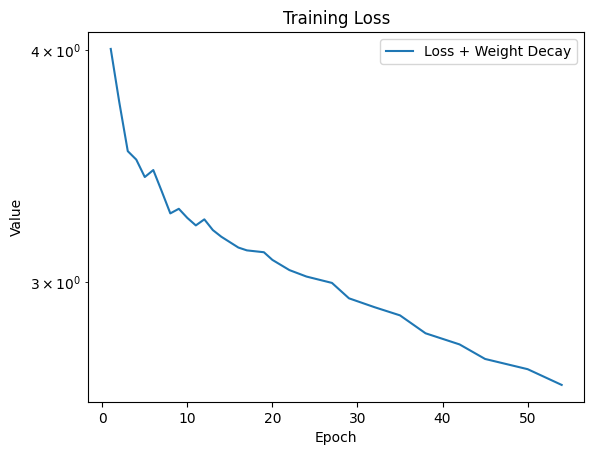
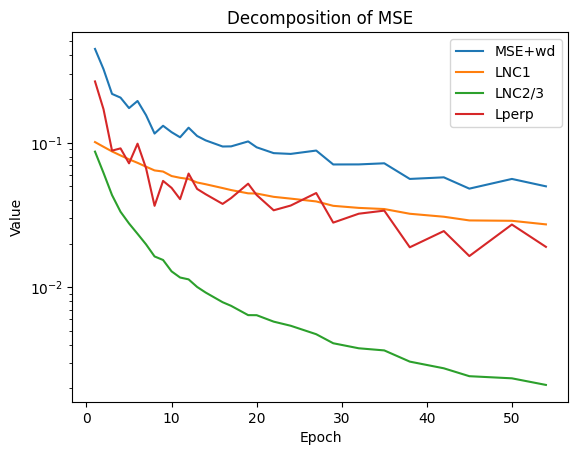

# Neural Collapse Replication

An exploration of how a classifier's learned features and final-layer weights develop structure during training. I studied Neural Collapse through a paper presentation, a technical report, and a ResNet-18 replication on MNIST.

**[Read the report](Project_Report.pdf)** · [Open the notebook](neuralcollapse.ipynb) · [Open in Colab](https://colab.research.google.com/github/aliiqbal24/Neural-Collapse-Replication/blob/main/neuralcollapse.ipynb)

## The question

Accuracy is only one view of a trained classifier. Neural Collapse asks what happens to the geometry of its internal representations near the end of training. This project tracks the NC1–NC4 measurements and related MSE decomposition, with configurable cross-entropy and MSE objectives.

## A window into the experiment





*These are selected saved PNG figures extracted from the committed notebook, not newly generated results. Consult the notebook cells and report for metric definitions, experiment conditions, and interpretation. Saved outputs may reflect earlier executions and should not be assumed to match the current configuration.*

## Reproduce

Use Jupyter or Colab with Python 3.12 and the tested PyTorch/torchvision pair. The notebook uses PyTorch, torchvision, NumPy, SciPy, Matplotlib, tqdm, and IPython.

```bash
python -m venv .venv
# Activate the environment using your platform's activation command.
pip install torch==2.8.0 torchvision==0.23.0 --index-url https://download.pytorch.org/whl/cpu
pip install -r requirements.txt
jupyter notebook neuralcollapse.ipynb
```

`debug = True` shortens batches per epoch; the configured experiment still spans 350 epochs. For a bounded smoke run, use one epoch and `epoch_list = [1]`. Use `debug = False` for the full experiment. Change `loss_name` between `MSELoss` and `CrossEntropyLoss` to compare objectives. The notebook selects CUDA when available and otherwise uses CPU; a GPU is useful for full training.

## What this contributes

My work here is a replication and explanation of published research, rather than a claim to have discovered Neural Collapse. The report develops the technical discussion; the notebook makes the training and analysis inspectable. Experiments are stochastic, and this repository does not promise bit-for-bit reproduction or generalization beyond the recorded setup.

The notebook references the original work by Papyan, Han, and Donoho and subsequent Neural Collapse research. See its references and the report for attribution.

For a less technical reflection: [Neural Collapse, in plain language](https://x.com/TheAli_Iqbal/status/2052066612162003396).
